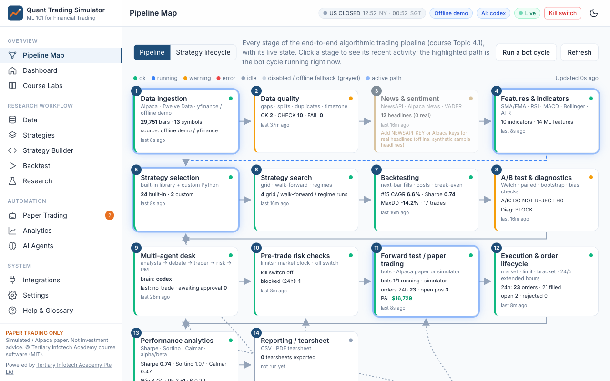
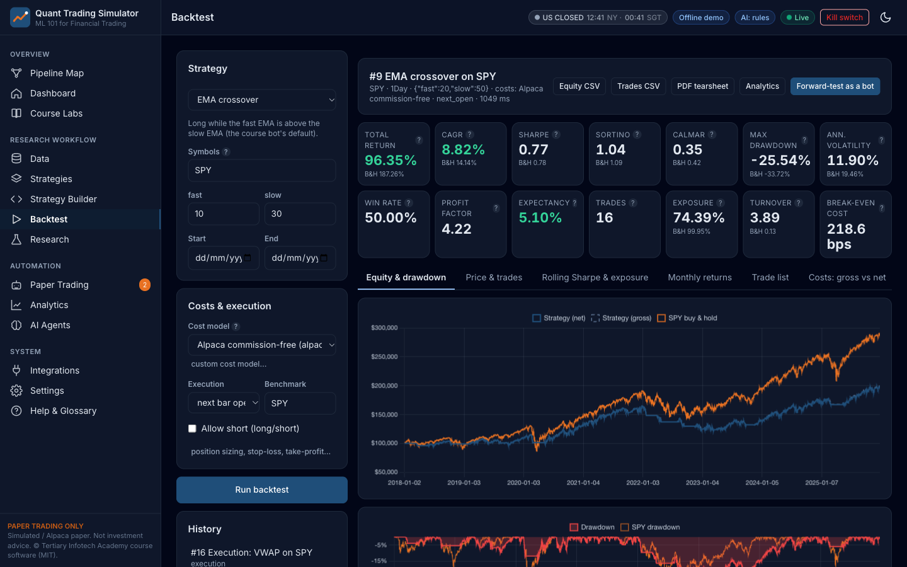
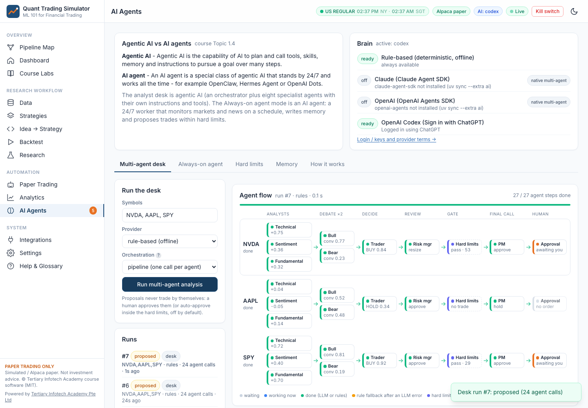

# Quant Trading Simulator

**A quant / algorithmic trading simulator for learning, paper trading only.** It is the companion software for the IBF course
**Machine Learning 101 for Financial Trading** by Tertiary Infotech Academy Pte Ltd. You can do all 20 course labs in the app:
data, indicators, strategies, backtests with realistic costs, research and statistics, a multi-agent AI desk, and automated
paper trading. It runs offline with **zero keys**. Add Alpaca, TradingView, Twelve Data, Equibles, NewsAPI or an AI login when you need them.


> **Disclaimer.** This is paper trading and simulation only. There is **no live-money order path**. Alpaca is always called
> with `paper=True`, and without keys a built-in simulator broker is used. All results are hypothetical, and past performance
> does not predict future results. **Nothing here is investment advice.** The demo market data comes from Yahoo Finance via
> yfinance, for educational use. The demo headlines and the offline sentiment series are **synthetic**.



## Contents

- [What's new in v2](#whats-new-in-v2)
- [Features mapped to the course](#features-mapped-to-the-course)
- [Architecture](#architecture)
- [Getting started](#getting-started)
  - [Option A: uv (Python only, SQLite)](#option-a-uv-python-only-sqlite)
  - [Option B: Docker Compose (Postgres)](#option-b-docker-compose-postgres)
  - [First run: onboarding](#first-run-onboarding)
  - [AI login](#ai-login-optional)
  - [Troubleshooting](#troubleshooting)
- [Configuration (.env)](#configuration-env)
- [Integrations](#integrations)
- [Custom strategy guide](#custom-strategy-guide)
- [Screenshots](#screenshots)
- [Development and tests](#development-and-tests)
- [User guide](#user-guide)
- [Licence and attribution](#licence-and-attribution)

## What's new in v2

v1 was a small Streamlit dashboard that used Google **Gemini** for "AI insights". v2 rebuilds it from scratch as a full
course simulator:

- **Gemini is gone.** The AI layer is now a **multi-agent desk** powered by **OpenAI Codex (Sign in with ChatGPT)**, the
  **Claude Agent SDK** or the **OpenAI Agents SDK**. A deterministic rule-based desk is the fallback.
- **No coding needed.** **Idea → Strategy** turns a trading idea written in plain English into a validated strategy (the
  connected AI writes it; with no AI, a built-in interpreter covers the common strategy families), shows the rules it
  understood, and backtests it with costs in one click.
- **No terminal for keys.** Paste API keys into the **Integrations** page and press **Save & test**: they are used at once,
  stored only on your computer (`data/keys.env`, git-ignored) and always shown masked.
- **Company data from Equibles.** With a free [Equibles](https://equibles.com) key, **Data > Company data** shows valuation
  multiples against peers, FINRA short interest, SEC insider trades and 13F ownership for any US ticker, and Equibles
  becomes a daily-price source.
- **Strategy library in lab order.** Strategies are grouped by type in the order the labs teach them (benchmark, trend,
  momentum, mean reversion, breakout, pairs, ML, sentiment and agents, execution, market making, custom) and can be
  filtered by the lab that uses them.
- **Run history on Analytics.** Search and filter every backtest, tick 2-5 runs to compare, and delete your own runs. The
  course sample runs the labs refer to are protected and always listed.
- **TSLA in the demo data** (13 symbols), with EMA crossover and buy-and-hold samples on AAPL and TSLA, and a date range
  (**From / To**) on the Data chart.
- **In-sample tuning for the ML models (Lab 11).** Each walk-forward refit tunes the model's main setting on its training
  window (75% fit, 25% validation), refits the winner and only then predicts unseen bars. The page compares in-sample,
  validation and out-of-sample AUC per model and per refit, so overfitting is visible.
- **Labs on your own symbol.** Set a **Test symbol** on the Course Labs page and every step's **Open** button uses it instead
  of the lab default (pair and multi-symbol steps keep theirs). The list holds the 13 demo stocks (KO, PEP, TSLA, AAPL, ...)
  plus any ticker you fetched, and **Other ticker…** takes any US ticker. Every symbol box lists them all on click, and
  the Research tabs follow the lab order (hypothesis, search, walk-forward, ML, regimes, A/B, pairs, diagnostics).
- The v1 code is kept, unchanged, in [`legacy/`](legacy/) for reference. It is the only place Gemini still appears.

## Features mapped to the course

| Course topic | In the app |
|---|---|
| **1. Foundations** - quant history, forms of data, big data, hypotheses, AI agents vs agentic AI | **Data:** Alpaca / Twelve Data / Equibles / yfinance / offline demo ingestion (13 symbols), multi-timeframe bars, Equibles company data (valuation, short interest, insider trades, ownership), data-quality checks (gaps, splits, duplicates, timezone), NewsAPI + Alpaca News headlines with VADER sentiment, and validation against TradingView (raw vs adjusted, SGX:D05 + AAPL). **Research > Hypothesis test:** H0/H1, Welch t-test, bootstrap CI, robustness grid and Bonferroni. **AI Agents** page: the taxonomy (agentic AI vs AI agent). |
| **2. Indicators, strategies, metrics, TradingView & Alpaca** | **Chart:** TradingView Lightweight Charts with SMA/EMA, Bollinger, Donchian, VWAP, RSI, MACD, ATR, stochastic and OBV. **Strategy library:** buy-and-hold, SMA/EMA crossover, MACD, RSI, RSI(2), Bollinger reversion and breakout, Donchian, time-series and cross-sectional momentum, dip-buy, pairs, regime-filtered, ML (logistic / random forest / XGBoost), sentiment, VWAP/TWAP/POV execution, market making and the agentic desk, grouped by strategy type in lab order and filterable by lab. Each has course explanations and classification tags. **Pine Script v6 export.** **Order ticket:** market, limit, stop, bracket, time-in-force and 24/5 extended hours. **Analytics:** every course metric. |
| **3. ML, statistics, A/B testing** | **Research:** grid search with in-sample / out-of-sample decay heatmap and robust region, walk-forward optimisation, ML classifiers with walk-forward validation and in-sample hyperparameter tuning on a validation hold-out (in-sample vs validation vs out-of-sample AUC, feature importance), PCA + walk-forward K-means regimes with a gate, A/B test (Welch, paired, block-bootstrap Sharpe CI, decision, multiple-testing caution), and an Engle-Granger cointegration screen with a hedged pairs backtest. |
| **4. End-to-end pipeline** - backtest with costs, forward test, diagnostics, reporting | **Backtest engine:** next-bar execution (no look-ahead), commission per share / bps / minimum, spread, slippage, SEC/FINRA fees on sells, borrow, long/short, multi-asset, position sizing (percent, fixed, vol-target, ATR), stop-loss / take-profit, gross vs net and break-even cost. **Paper trading bots:** scheduled, with risk checks and kill switches, an offline replay mode and live mode (Alpaca 24/5). **TradingView webhook.** **Diagnostics:** look-ahead, cost drag, overfitting, survivorship. **Tearsheet** PDF/CSV, backtest vs forward comparison, and a searchable **run history** (compare 2-5 runs, delete your own; course samples are protected). **Pipeline Map** of all 14 stages. |
| **Course labs 1-20** | **Course Labs** page, driven by [`labs/course_labs.yaml`](labs/course_labs.yaml). It gives step-by-step checklists with deep links and presets, saves progress per user, lets you run every step on a **test symbol** of your choice, and offers optional "under the hood" Python. |

More highlights:

- **Pipeline Map.** All 14 stages of the quant workflow, from data ingestion to reporting, appear with live status, key
  figures, tooltips and recent events. The active bot cycle is highlighted over SSE, and stages that are disabled or running
  on an offline fallback are greyed out. A second view, **Strategy lifecycle**, shows one strategy's path from idea to
  analytics with pass/fail gates.
- **Multi-agent AI desk.** It runs eight agents: technical, sentiment/news and fundamental-lite analysts, bull and bear
  researchers who debate over two rounds, a trader, a risk manager, and a portfolio manager / orchestrator.
  - **Hard risk limits run in code, outside the LLM.** No model output can loosen them.
  - **A human must approve** every proposal before any paper order is sent. Auto-approve inside the limits is optional.
  - Every agent's output is saved in a **decision trace**.
  - The **Agent flow** view shows the desk as a live pipeline, one row per symbol: analysts → bull/bear debate → trader
    → risk manager → hard limits (code) → portfolio manager → human approval. Each agent turns from waiting to working
    to done (or rule fallback) as the run progresses, with its score or decision. Finished runs are redrawn from their trace.
  - **Always-on agent mode** runs the desk around the clock on a schedule and writes memory.
- **Custom strategies.** Write Python in the browser (CodeMirror) against a documented plugin API, starting from templates
  or a clone of a built-in strategy. The code is validated, test-run in a restricted subprocess, and checked for look-ahead.
  Saved strategies appear everywhere in the app.
- **Live updates.** Orders, fills, bot cycles and pipeline stages stream to the browser over Server-Sent Events. This works
  across the API and worker processes.

## Architecture

```mermaid
flowchart LR
  subgraph Browser["Browser (no build step)"]
    UI["SPA: Alpine.js + Tailwind CDN<br/>Lightweight Charts · Chart.js · CodeMirror"]
  end
  subgraph Server["Python (FastAPI)"]
    API["REST /api + OpenAPI /docs<br/>SSE /api/events/stream"]
    Core["core: indicators · metrics · costs<br/>backtest engine · stats · pairs · regimes · ML"]
    Strat["strategies: 24 built-ins<br/>plugin API + sandbox · Pine export"]
    Broker["brokers: Simulator · Alpaca PAPER<br/>risk checks · kill switch"]
    Agents["multi-agent desk<br/>Codex · Claude Agent SDK · OpenAI Agents SDK · rules"]
    WH["TradingView webhook"]
  end
  Worker["worker (APScheduler)<br/>bots · always-on agent · sim matching"]
  DB[("SQLite / Postgres<br/>SQLAlchemy 2 + Alembic")]
  Ext["Alpaca · Twelve Data · Equibles · yfinance<br/>NewsAPI · TradingView"]
  UI <--> API
  API --> Core & Strat & Broker & Agents & WH
  Worker --> Broker & Agents & Core
  API <--> DB
  Worker <--> DB
  Broker <--> Ext
  Core <--> Ext
  WH <-- alerts --- Ext
```

| Layer | Technology |
|---|---|
| Backend | FastAPI, SQLAlchemy 2, Alembic, pydantic-settings, APScheduler, SSE |
| Quant | pandas, NumPy, SciPy, scikit-learn, XGBoost, VADER, matplotlib (tearsheets) |
| Brokers / data | alpaca-py (`paper=True`), Twelve Data REST, Equibles REST, yfinance, NewsAPI, bundled demo CSVs |
| AI | `openai-codex` (Codex SDK, ChatGPT login), `claude-agent-sdk`, `openai-agents` (optional extra `ai`) |
| Frontend | Static HTML/JS: Alpine.js 3, Tailwind (Play CDN), TradingView Lightweight Charts 5, Chart.js 4, CodeMirror 5, marked |
| Deployment | uv (SQLite) or Docker Compose (`db` postgres:16, `backend`, `worker`, `frontend` nginx) |

The source code is organised as follows: `src/trader/core` (engine and maths), `strategies`, `data`, `sentiment`, `broker`,
`bots`, `agents`, `services`, `api`, `web` (the SPA), `scheduler.py` and `cli.py`. Migrations are in `alembic/`, the lab
manifest is in `labs/`, and documentation and screenshots are in `docs/`.

## Getting started

### Option A: uv (Python only, SQLite)

**Prerequisites:** Git and [uv](https://docs.astral.sh/uv/). uv installs Python 3.12 for you if needed; any Python 3.11+ works.

```bash
# macOS / Linux
curl -LsSf https://astral.sh/uv/install.sh | sh
# Windows (PowerShell)
powershell -ExecutionPolicy ByPass -c "irm https://astral.sh/uv/install.ps1 | iex"
```

**Install and start:**

```bash
git clone https://github.com/alfredang/algorithmic-trader-bot
cd algorithmic-trader-bot
cp .env.example .env              # Windows: copy .env.example .env   (all values may stay blank)
uv sync                           # add  --extra ai  for the Codex / Claude / OpenAI agent SDKs
uv run trader seed                # demo data, sample backtests and research runs (~15 s)
uv run trader serve --with-worker # API + web app + scheduler in one process
```

Open **http://localhost:8000** in your browser. The API docs are at http://localhost:8000/docs.

- You can also start the app with `uv run python -m trader`, which runs `serve` without the worker.
- To run the worker as a separate process, open a second terminal and run `uv run trader worker`. Run the worker only one way:
  either `--with-worker` or a separate `trader worker`.
- **To stop**, press `Ctrl+C` in each terminal. The data stays in `./data/trader.db`.
- Other commands: `uv run trader status` (configuration and AI provider status), `uv run trader migrate`,
  `uv run trader backtest ema_cross --symbols SPY --param fast=20 slow=50`, and `uv run trader agents --symbols NVDA SPY`.

### Option B: Docker Compose (Postgres)

**Prerequisites:** [Docker Desktop](https://www.docker.com/products/docker-desktop/) or Docker Engine with Compose v2.

```bash
git clone https://github.com/alfredang/algorithmic-trader-bot
cd algorithmic-trader-bot
cp .env.example .env                       # optional: set POSTGRES_PASSWORD and any keys
docker compose up -d --build               # db (postgres:16) + backend + worker + frontend (nginx)
docker compose exec backend trader seed    # load the offline demo data
```

Open **http://localhost:8000**. The frontend is published on `APP_PORT`, which defaults to 8000. nginx proxies `/api`,
`/docs` and the SSE stream to the backend.

```bash
docker compose ps                          # all four services should be "healthy"
docker compose logs -f                     # follow the logs (Ctrl+C to stop following)
docker compose down                        # stop; the database volume is kept
docker compose down -v                     # stop AND DELETE the database volume - wipes all data
```

To include the LLM SDKs in the image, set `UV_EXTRAS=--extra ai` in `.env` and rebuild. Inside a container, use API keys.
The Codex ChatGPT login lives on your own machine; see [AI login](#ai-login-optional).

### First-run onboarding

On first launch a welcome wizard guides you through four steps:

1. Confirm the **paper-only** rules.
2. Choose **offline demo** or **Alpaca paper**. Offline is the default. For Alpaca, put `APCA_API_KEY_ID` and
   `APCA_API_SECRET_KEY` on the **Integrations** page and press **Save & test** (no restart; stored in `data/keys.env`).
   Setting them in `.env` also works.
3. See which **AI brain** is active.
4. **Load the demo data**, if you have not run `trader seed` yet.

You can re-open the wizard from **Settings**.

### AI login (optional)

| Provider | Auth (primary first) | How |
|---|---|---|
| **OpenAI Codex**, Sign in with ChatGPT (subscription) | Your own local Codex CLI login | `uv sync --extra ai` (it bundles the Codex CLI) or install the Codex CLI. Run `codex login`, choose **Sign in with ChatGPT**, and check with `codex login status`. The app asks Codex only *whether* you are logged in. It never reads, stores or proxies tokens, which stay in `~/.codex` or your OS keyring. |
| **Claude**, Claude Agent SDK | `ANTHROPIC_API_KEY` (or Bedrock / Vertex env vars) | Create a key at console.anthropic.com. **Claude.ai subscription login is not offered** (see the terms note below). |
| **OpenAI Agents SDK** | `OPENAI_API_KEY` | Create a key at platform.openai.com. |
| Rule-based | none | Always available. This is the deterministic multi-role desk. |

`AI_PROVIDER=auto` uses Codex if you are logged in, then any configured API key, then the rule-based desk. You can also
choose a provider for each run on the AI Agents page.

**Provider terms.** Read these before you enable a provider.

- **Anthropic.** "Unless previously approved, Anthropic does not allow third party developers to offer claude.ai login or
  rate limits for their products, including agents built on the Claude Agent SDK." ([Agent SDK overview](https://code.claude.com/docs/en/agent-sdk/overview))
  "Developers building products or services that interact with Claude's capabilities, including those using the Agent SDK,
  should use API key authentication through Claude Console or a supported cloud provider. Anthropic does not permit
  third-party developers to offer Claude.ai login into their own applications, or to route requests through Free, Pro, or
  Max plan credentials on behalf of their users." ([Legal and compliance](https://code.claude.com/docs/en/legal-and-compliance))
  For these reasons the Claude provider here uses **API keys or cloud credentials only**. It passes only those credentials
  to the SDK and never loads your Claude Code settings or login.
- **OpenAI.** Codex caches its login locally in `~/.codex/auth.json` or the OS credential store
  ([Codex auth](https://developers.openai.com/codex/auth)). The official Python Codex SDK (`openai-codex`) reuses that login
  ([Codex SDK](https://developers.openai.com/codex/sdk)). OpenAI documents plan usage for **open-source, locally hosted**
  apps whose requests come from the user's own runtime
  ([token sharing for open-source apps](https://developers.openai.com/siwc/token-sharing-open-source),
  [Sign in with ChatGPT terms](https://openai.com/policies/sign-in-with-chatgpt-terms/)). That is how this app uses it:
  on your machine, with your login.
  - Do **not** use one person's subscription to serve other users.
  - Hosted or paid deployments need OpenAI's approval or API keys.
  - The OpenAI Agents SDK itself supports API keys only.

### Troubleshooting

| Symptom | Fix |
|---|---|
| `address already in use` / port 8000 busy | `uv run trader serve --port 8010`, or set `APP_PORT=8010` in `.env` (Docker publishes the frontend on `APP_PORT`). |
| `unable to open database file` / DB errors | SQLite: check that `DATABASE_URL` points to a writable path (the default `./data/` is created automatically). Docker: wait until `db` is healthy (`docker compose ps`) and look at `docker compose logs backend`. A Postgres URL needs the `postgresql+psycopg://` scheme. |
| Empty pages / no backtests | Run `uv run trader seed` (Docker: `docker compose exec backend trader seed`) or use **Settings > Load demo data**. |
| Integrations show "not configured" | Paste the key into its card on **Integrations** and press **Save & test** (used at once, stored in `data/keys.env`). Keys in `.env` are read at start-up. Keys are never stored in the database. |
| AI desk says `rules` / "not logged in" | Run `codex login` (Sign in with ChatGPT) on the machine that runs the app, or set `ANTHROPIC_API_KEY` / `OPENAI_API_KEY`. Install the SDKs with `uv sync --extra ai`. |
| Orders stay `accepted` / not filled | The US market is closed, so orders queue as GTC limits. Outside 09:30-16:00 ET, only extended-hours **limit** orders are accepted (Singapore class hours fall in the US overnight session). In the simulator use **Process working orders** or the ticket's *Session (sim)* override. Replay bots fill on their own bars. |
| A running bot does nothing | Check that a worker is running (`--with-worker`, `trader worker`, or the Docker `worker` service), and that neither the global kill switch nor the bot's kill switch is ON. |
| A custom strategy fails validation | Read the issue list. Only allow-listed imports are permitted, with no dunder attributes and no `open`/`eval`. Code that runs longer than `SANDBOX_TIMEOUT_S` is stopped. |

## Configuration (.env)

Every variable is optional. See [`.env.example`](.env.example).

| Variable | Default | Purpose |
|---|---|---|
| `DATABASE_URL` | `sqlite:///./data/trader.db` | SQLAlchemy URL. Compose sets the Postgres URL. |
| `APP_HOST` / `APP_PORT` | `127.0.0.1` / `8000` | Bind address for `trader serve` (and the Compose frontend port). |
| `LOG_LEVEL` | `info` | Uvicorn / app log level. |
| `CORS_ORIGINS` | blank | Extra allowed origins (comma-separated). |
| `RUN_SCHEDULER_IN_PROCESS` | `false` | Run the worker inside the web process. |
| `AUTO_SEED` | `false` | Seed the demo data if the DB is empty. |
| `DESK_TIMEZONE` | `Asia/Singapore` | Desk timezone shown with the US clock. |
| `DEFAULT_DATA_SOURCE` | `auto` | `auto`, `demo`, `alpaca`, `twelvedata`, `equibles` or `yfinance`. |
| `APCA_API_KEY_ID` / `APCA_API_SECRET_KEY` | blank | Alpaca **paper** keys. |
| `APCA_DATA_FEED` | `iex` | `iex` (free) or `sip`. |
| `TWELVEDATA_API_KEY` | blank | Twelve Data time series. |
| `NEWSAPI_KEY` | blank | NewsAPI.org headlines. |
| `EQUIBLES_API_KEY` | blank | Equibles daily prices and company data (valuation, short interest, insiders, ownership). |
| `AI_PROVIDER` | `auto` | `auto`, `rules`, `codex`, `claude` or `openai`. |
| `ANTHROPIC_API_KEY` | blank | Claude Agent SDK (API key auth). |
| `CLAUDE_MODEL` / `CLAUDE_MODEL_DEEP` | `claude-sonnet-5-5` / `claude-opus-5-5` | Claude models. |
| `OPENAI_API_KEY` | blank | OpenAI Agents SDK. |
| `OPENAI_MODEL` / `CODEX_MODEL` | blank | Blank means the SDK / CLI default. |
| `AGENT_TIMEOUT_S` | `120` | Per-agent LLM timeout. |
| `AGENT_AUTO_APPROVE` | `false` | Auto-approve proposals that pass the hard limits. |
| `ALWAYS_ON_INTERVAL_MIN` | `60` | Default wake-up interval of the always-on agent. |
| `WEBHOOK_SECRET` | blank | TradingView shared secret. If blank, one is generated locally on first use. |
| `SANDBOX_TIMEOUT_S` / `SANDBOX_MEMORY_MB` | `30` / `1024` | Custom-strategy sandbox limits. |
| `POSTGRES_USER` / `POSTGRES_PASSWORD` / `POSTGRES_DB` | `trader` / (falls back to `trader`) / `trader` | Docker Compose database. |
| `UV_EXTRAS` | blank | `--extra ai` adds the LLM SDKs to the Docker image. |

## Integrations

- **Alpaca (paper).** In app.alpaca.markets switch to your Paper account, Home > API Keys > Generate New Keys, then paste both values into the Alpaca card on **Integrations** and press **Save & test**. (Or put them in `.env`.)
  - The app uses the Alpaca Market Data API (IEX feed, adjusted), Alpaca News, the market clock and the Trading API, with
    `TradingClient(..., paper=True)` hard-coded.
  - Bots and the order manager are **session-aware**:
    - regular session: market (or bracket) orders
    - pre-market, after-hours and overnight (24/5): **LIMIT orders, DAY, `extended_hours=True`**, priced off the quote
      ± 25 bps
    - closed: GTC limits that queue for the next session
- **TradingView.**
  - **Integrations > TradingView webhook** shows the URL (`/api/webhooks/tradingview`), the JSON alert message and the shared
    secret. Use **Reveal** to show the secret; it is masked by default.
  - Alerts are checked for the secret, the allow-list and the maximum quantity. Duplicate alert ids (TradingView retries) are
    ignored. Each alert is confirmed against the app's own signal (with an optional 409 veto), run through the pre-trade risk
    checks, and sent as a paper order. Every alert is written to the audit log.
  - Webhooks need a paid TradingView plan and a public HTTPS URL (for example `ngrok http 8000`).
  - The built-in **self-test** sends 7 simulated alerts.
  - Pine Script v6 exports, with `alert_message` included, are in the Strategy Library.
- **Twelve Data.** Set `TWELVEDATA_API_KEY` and pick "Twelve Data" as the source on the Data page. The key is checked
  against `/api_usage`.
- **Equibles.** Paste a key from equibles.com > Dashboard > API keys on the Integrations page (or set `EQUIBLES_API_KEY`).
  - **Data > Company data** shows valuation multiples against peers, FINRA short interest, SEC insider transactions and
    13F ownership for a US ticker. Each load uses 5 requests and is cached for 6 hours.
  - "Equibles" is also a daily-price source on the Data page (OHLC scaled by `adjustedClose`, so bars are split- and
    dividend-adjusted like the other sources). Intraday bars are not available.
  - The free plan allows 100 requests a day, shared with Equibles' MCP server, and resets at 00:00 UTC. The
    connection test calls `/v1/market/status` (1 request).
- **NewsAPI.** Set `NEWSAPI_KEY`. The app uses `/v2/everything` with the `X-Api-Key` header. The free Developer plan is for
  development only (24 h delay, 100 requests/day).
- **LLM providers.** See [AI login](#ai-login-optional). The Integrations page shows the login status, the exact login
  command and the provider terms.

## Custom strategy guide

**Most learners never need this section.** Open **Idea → Strategy**, describe the idea in plain English and press **Turn my
idea into a strategy**: the app writes the code below for you, runs the sandbox and look-ahead checks, saves it, and
**Test it now** backtests it. The rest of this section is for anyone who wants to read or edit the code.

```python
from trader.core import indicators as ta
from trader.strategies.base import Strategy, flat_until_ready

class TrendWithRSIFilter(Strategy):
    """Long while EMA(fast) > EMA(slow), but skip entries when RSI says the move is stretched."""
    name = "EMA trend + RSI filter"
    params = {
        "fast": {"default": 20, "min": 2, "max": 200, "help": "Fast EMA"},
        "slow": 50,                                   # short form - type inferred
        "rsi_max": {"default": 75, "min": 50, "max": 95},
    }

    def generate_signals(self, data):                 # data: OHLCV DataFrame
        f, s = ta.ema(data["close"], self.p.fast), ta.ema(data["close"], self.p.slow)
        r = ta.rsi(data["close"], 14)
        return flat_until_ready((f > s) & (r < self.p.rsi_max), f, s, r)   # 1 long, 0 flat, -1 short
```

- **Signals** are target positions decided at the **close** of bar *t*. The engine fills them on the **next** bar, so
  never use future data.
- **Multi-asset** strategies set `multi_asset = True`, receive `{symbol: DataFrame}`, and return a DataFrame of weights.
- **Parameters** become a form on the Backtest page automatically.
- **Allowed imports:** pandas, numpy, math, statistics, scipy, sklearn and `trader.core.*`.
- **Workflow:** in **Strategy Builder**, pick a template or **clone a built-in**, then **Validate & test-run** (this runs the
  sandbox and the look-ahead check) and **Save**. The strategy then appears in the library and in backtests, research, bots
  and A/B tests.
- **Security:** user code runs in a separate `python -I` subprocess with an import allow-list, AST checks (no dunder
  attributes, no `open`/`exec`/`eval`/`getattr`), CPU-time and memory limits, a wall-clock timeout, and **no API keys** in
  its environment. This protects against accidents, not against determined attackers. **It is designed for local, trusted
  use.** Do not run other people's code on a shared server.

## Screenshots

| | |
|---|---|
|  Dashboard |  Course Labs |
|  Strategy lifecycle |  Data: chart and indicators |
|  Strategy library |  Strategy Builder |
|  Backtest |  Strategy search (decay heatmap) |
|  A/B test |  Diagnostics (Lab 18 exhibit) |
|  Regimes |  Paper-trading bot |
|  Analytics |  Multi-agent desk (Codex run) |
|  Integrations |  Dark mode |
|  Agent flow (per-agent status) | |

There are lab-by-lab screenshots in [`docs/screenshots/labs/`](docs/screenshots/labs/).

## Development and tests

```bash
uv sync                   # dev tools (pytest, ruff) are in the default dev group
uv run pytest             # offline suite - indicators, metrics, backtest, costs, pairs, A/B, risk, broker, strategies,
                          #   multi-agent orchestration and live agent progress (LLM mocked), API endpoints, in-app keys, Equibles (HTTP mocked),
                          #   migrations
uv run ruff check src tests alembic
uv run alembic revision --autogenerate -m "..."   # after changing models
```

## User guide

Read the task-based **[User Guide](docs/USER_GUIDE.md)** ([PDF](docs/User_Guide.pdf)). The app also shows it on the
**Help & Glossary** page.

## Licence and attribution

MIT licence (see [LICENSE](LICENSE)). It was built as course software for **Machine Learning 101 for Financial Trading** by
**Tertiary Infotech Academy Pte Ltd** (Singapore). The strategy explanations and metric definitions follow the course material.

- **Demo data:** Yahoo Finance via yfinance, for training use only (see `src/trader/data/demo/README.md`).
- **Demo headlines:** synthetic.
- **Multi-agent desk:** inspired by TradingAgents (Xiao et al., 2024, arXiv:2412.20138).
- **Trademarks:** Alpaca, TradingView, OpenAI, Anthropic and other names are trademarks of their owners. This project is not
  affiliated with or endorsed by them.
