# Quant Trading Simulator - User Guide

The companion software for the IBF course **Machine Learning 101 for Financial Trading** (Tertiary Infotech Academy).

> **Paper trading only.** There is no live-money order path. The app uses the Alpaca paper account (`paper=True`) or a
> built-in simulator. Results are hypothetical and nothing here is investment advice. The demo headlines and the offline
> sentiment series are synthetic.

This guide is organised by task. Each section says where to click and what you should see. For installation, see the
README ("Getting started").

---

## 1. Navigating the app

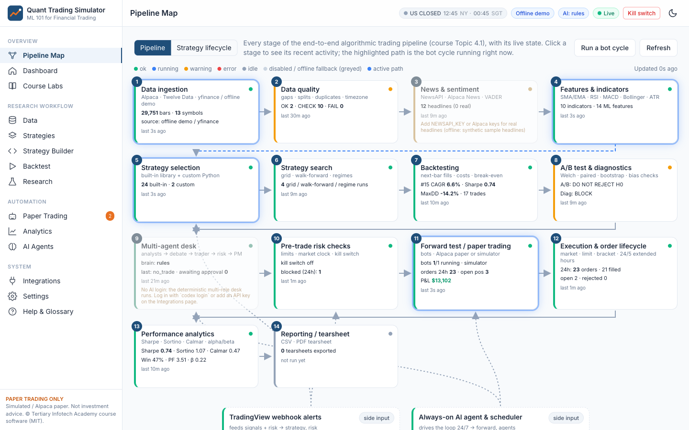

- **Sidebar.** The sidebar on the left groups the pages:
  - **Overview:** Pipeline Map, Dashboard, Course Labs
  - **Research workflow:** Data, Strategies, Strategy Builder, Backtest, Research
  - **Automation:** Paper Trading, Analytics, AI Agents
  - **System:** Integrations, Settings, Help & Glossary
  
  On a phone, open the sidebar with the ☰ button.
- **Top bar.** The top bar shows:
  - the **US session**, with New York and Singapore times
  - **Offline demo** or **Alpaca paper**
  - the active **AI brain**
  - a **Live** dot when real-time updates (SSE) are connected
  - the global **Kill switch**
  - the dark/light toggle
- **Tooltips.** Hover any metric or **?** icon to see its definition and formula.
- **Empty states.** When a page has no data yet, it tells you what to do next.
- **Welcome wizard.** The wizard runs on first launch. Re-open it from **Settings**.

### The Pipeline Map

The Pipeline Map shows the 14 stages of the end-to-end pipeline (course Topic 4.1), from left to right:

1. Data ingestion
2. Data quality
3. News & sentiment
4. Features & indicators
5. Strategy selection
6. Strategy search
7. Backtesting
8. A/B test & diagnostics
9. Multi-agent desk
10. Pre-trade risk checks
11. Forward test / paper trading
12. Execution & order lifecycle
13. Performance analytics
14. Reporting / tearsheet

Two **side inputs** feed the main flow: TradingView webhook alerts (into the strategy and risk stages) and the always-on
AI agent / scheduler (which drives the loop).

How to read a node:

- **Colour** shows its state: green *ok*, blue *running*, amber *warning*, red *error*, grey *idle*. A **greyed** node is
  disabled or running on an offline fallback, for example "no NewsAPI key" or "no AI login". Its hint tells you how to
  enable it.
- **Content.** Each node shows its last run time and key figures (bars cached, the last backtest's CAGR / Sharpe / max
  drawdown / trades, bots running, orders today, open positions, live P&L, and so on). Hover a node for a plain-language
  explanation.
- **Click a node** to open a side panel with its recent activity and an **Open page** button. For example, *Backtesting*
  opens the last backtest, and *Forward testing* opens the bot that ran last.
- **Run a bot cycle** runs one cycle of the demo bot so you can watch the **active path** light up: ingestion → features →
  signals → risk → execution → forward test → positions.

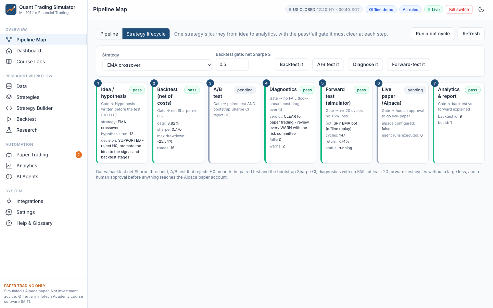

The **Strategy lifecycle** view follows one strategy from **idea → backtest → A/B → diagnostics → forward test →
live-paper → analytics**. Each step has a **pass/fail gate**:

- net Sharpe at or above a threshold you choose
- the A/B test rejects H0 on both the paired test and the bootstrap Sharpe CI
- diagnostics with no FAIL
- at least 20 forward-test cycles with no loss larger than 5%
- human approval before anything reaches the Alpaca paper account

### The Dashboard

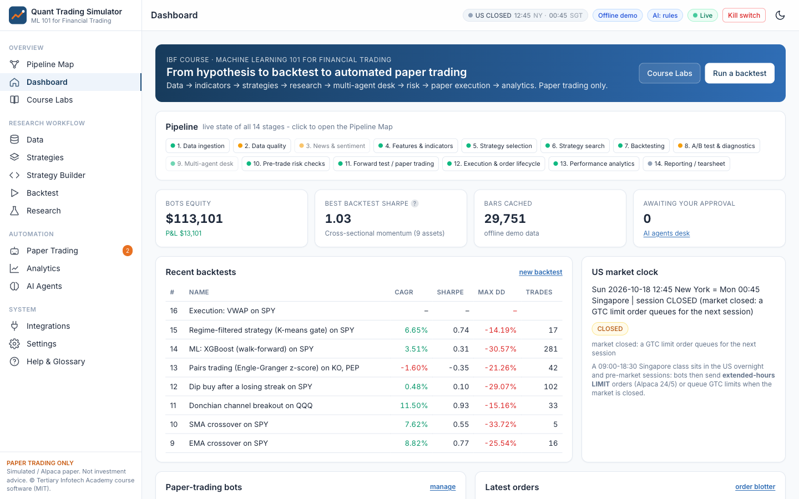

The Dashboard shows a compact pipeline strip, KPI cards (bots' equity and P&L, best backtest Sharpe, bars cached,
proposals awaiting your approval), recent backtests, the US market clock, the bots and the latest orders.

### Course Labs

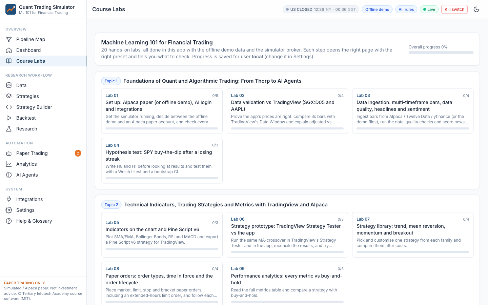

**Course Labs** lists Labs 1-20, grouped by the four course topics. To work through a lab:

1. Open the lab to see its objective and a step-by-step checklist.
2. In each step, read the instruction and press **Open: …**. This opens the right page with the right **preset**, for
   example *Backtest SPY EMA 20/50, Alpaca costs*.
3. Compare what you see with the **Check** (the expected result).
4. Tick the box. Your progress is saved with a timestamp for the user name set in **Settings**. **Reset progress** clears
   it for that lab.

**Test on another stock.** Pick a stock in the **Test symbol** list at the top of Course Labs (or of any lab), for example
KO, PEP, TSLA or AAPL. The list holds the 13 bundled demo stocks plus anything you have fetched; **Other ticker…** takes any
US ticker, whose daily bars are downloaded the first time a page uses it. Every step's **Open** button then uses that stock
instead of the lab's default (SPY etc.). Pair and multi-symbol steps keep their own symbols, and the **Check** notes were
written for the default, so your numbers will differ. Pick **Lab defaults** to go back. Every symbol box in the app also
lists all these stocks when you click into it.

Optional **Under the hood** panels give the equivalent Python or an AI-assistant prompt. The course team edits the labs in
`labs/course_labs.yaml`; no code changes are needed.

---

## 2. Loading data

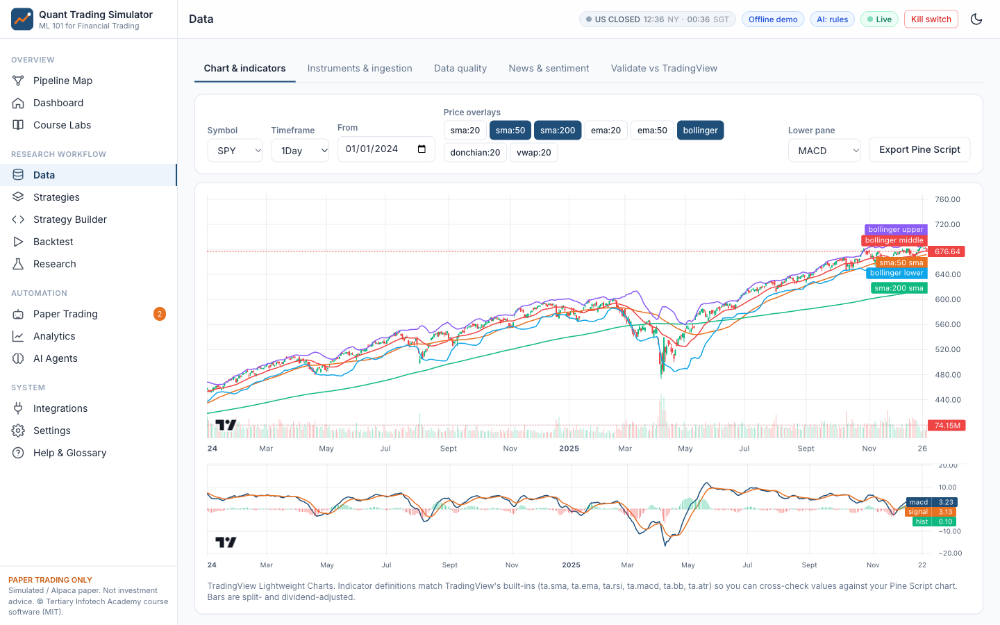

1. **Data > Instruments & ingestion.** Enter a symbol, pick a source and press **Fetch, check quality and cache**.
   - *auto* means Alpaca if you have keys, else the bundled demo file, else yfinance.
   - You can also pick Alpaca, Twelve Data, Equibles (daily bars only) or yfinance directly.
   - Daily and hourly bars are cached. Weekly and monthly bars are resampled from daily bars.
2. **Chart & indicators.** Toggle overlays (SMA, EMA, Bollinger, Donchian, VWAP) and choose a lower pane (RSI, MACD, ATR,
   stochastic, OBV). The definitions match TradingView's built-ins, so you can cross-check values against your Pine chart.
3. **Data quality** checks for missing values, duplicate timestamps, an unsorted index, high < low, close outside the range,
   zero volume, gaps longer than 4 days, big moves (possible unadjusted splits), stale data and timezone. Status is OK,
   CHECK or FAIL.
4. **News & sentiment.** Press **Fetch & score headlines**.
   - The source is NewsAPI.org if `NEWSAPI_KEY` is set, else Alpaca News, else synthetic sample headlines.
   - Each headline gets a VADER score from −1 to +1, and the scores are averaged per day.
   - You can test the model on your own sentence.
5. **Company data.** Needs an Equibles key (Integrations page). Type a US ticker and press **Load**.
   - You see the latest close and 52-week range, P/E, EV/Revenue and EV/EBIT against the median of similar-size peers,
     13F / insider ownership, FINRA short interest and recent SEC insider transactions.
   - Each load uses 5 of the 100 free daily requests and is cached for 6 hours. **Refresh** skips the cache.
   - ETFs have no valuation multiples or insider trades; those sections say so.
6. **Validate vs TradingView (Lab 02).** Type the values you read in TradingView's Data Window for NASDAQ:AAPL or SGX:D05.
   - The app compares them with **RAW** bars (split-adjusted only, which is TradingView's default) and **ADJUSTED** bars
     (split- and dividend-adjusted, which is what backtests use).
   - It gives a PASS / FAIL verdict and the adjustment factor.

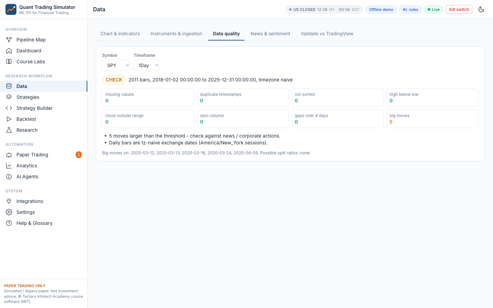

---

## 3. Choosing and customising a strategy

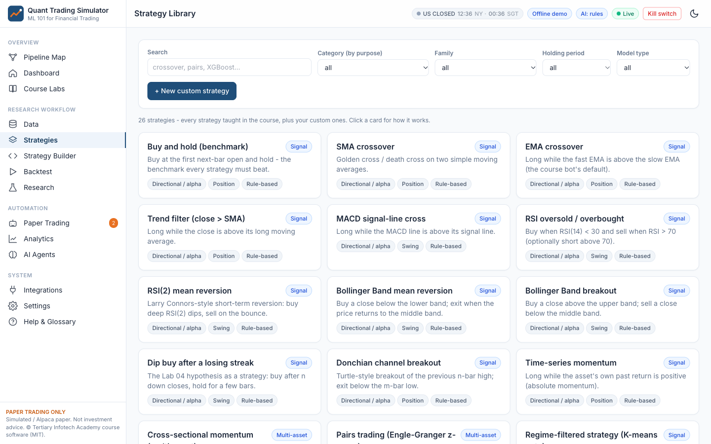

**Strategies** lists every strategy taught in the course. You can filter by:

- **category** (by purpose): execution, market making, arbitrage, directional, statistical arbitrage and pairs, factor and
  portfolio, hedging
- **family**
- **holding period**
- **model type**: rule-based, statistical, machine learning, LLM and agentic

Click a card to see:

- **How it works / Rule / Works best when / Watch out for**, in the course wording
- the parameter table
- the actions: **Backtest**, **Clone to Strategy Builder**, **Pine Script v6** export (copy and paste into TradingView's
  Pine Editor; it fills on the next bar's open like the app) and **Create paper bot**

---

## 4. Turning your idea into a strategy (no coding)

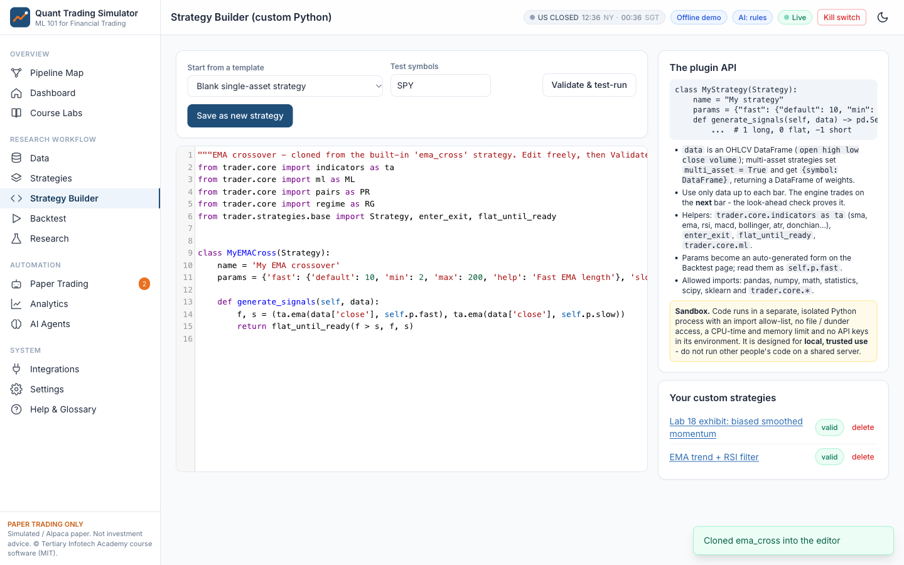

1. Open **Idea → Strategy** (sidebar, or **Test a trading idea** on the Dashboard).
2. **Describe the idea** in a sentence or two: the signal, when to buy, when to sell. Numbers help, e.g. *"Buy when
   RSI(14) drops below 30 and sell when it rises above 70"*. Or click one of the example ideas.
3. Choose the symbol to test on (default SPY) and press **Turn my idea into a strategy**.
   - With an AI connected (OpenAI Codex sign-in, or a Claude / OpenAI API key on **Integrations**) the AI writes the strategy.
   - With no AI, the built-in interpreter handles the common families: moving-average crossover, RSI, Bollinger Bands,
     breakout, buy-the-dip, MACD and momentum.
4. The app **checks the code for you**: a test run on real data and a **look-ahead check** that proves it never uses
   future prices. It then saves the strategy and shows **how it understood your idea** in plain English. If those rules are
   not what you meant, rephrase and try again.
5. Press **Test it now**: a backtest with realistic Alpaca trading costs, compared with buy-and-hold. From there you can
   **Optimise the numbers** (Research > Grid) or **Forward-test it** on paper.

You never have to read or write code. **Show the code (optional)** reveals it, and **Advanced: write or edit the code
yourself** opens the editor with templates and the plugin API (`generate_signals(self, data)` returning 1 long, 0 flat,
−1 short) for anyone who wants to go further.

> The sandbox (import allow-list, no file or dunder access, CPU, memory and time limits, no API keys) is for **local,
> trusted use**.

---

## 5. Running a backtest and reading the metrics

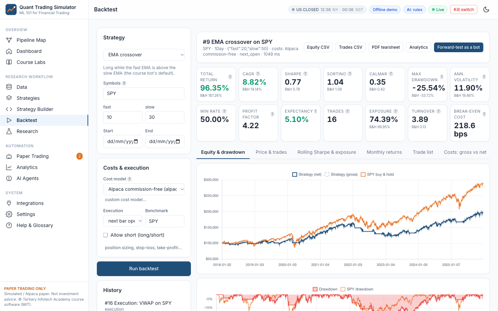

1. **Backtest.** Pick a strategy, symbols and parameters.
2. Choose a **cost model**:
   - *zero*
   - *Alpaca commission-free* (spread, slippage, SEC/FINRA fees on sells, borrow)
   - *per-share broker*
   - *high-cost route*
   - a **custom** model (commission per share / bps / minimum, spread, slippage, borrow)
3. Choose **execution**: next bar open (the default, like TradingView) or next bar close. Optionally **allow short**.
4. Optionally set **position sizing** (% of equity, fixed notional, volatility target, ATR risk), a **stop-loss** and a
   **take-profit**.
5. Press **Run backtest**.

Reading the results:

- **Metric cards.** Each card shows the strategy value, with buy-and-hold underneath. Hover for the formula.
- **Equity & drawdown:** the net and gross curves against the benchmark.
- **Price & trades:** Lightweight Charts with buy and sell markers.
- **Rolling Sharpe & exposure.**
- **Monthly returns** heatmap.
- **Trade list:** gross and net return, P&L and the exit reason.
- **Costs: gross vs net:** the breakdown by type, the cost drag, and the **break-even one-way cost**, which is the bps at
  which net CAGR reaches zero.
- **All metrics** table.

Use **PDF tearsheet**, **Equity CSV** and **Trades CSV** to export, and **Forward-test as a bot** to start a paper bot
with the same settings.

The engine always trades on the **next** bar, so there is no same-bar fill path. For *execution* strategies
(VWAP/TWAP/POV) the page shows child orders, slippage against the session VWAP and implementation shortfall. For *market
making* it shows spread captured, inventory P&L and inventory.

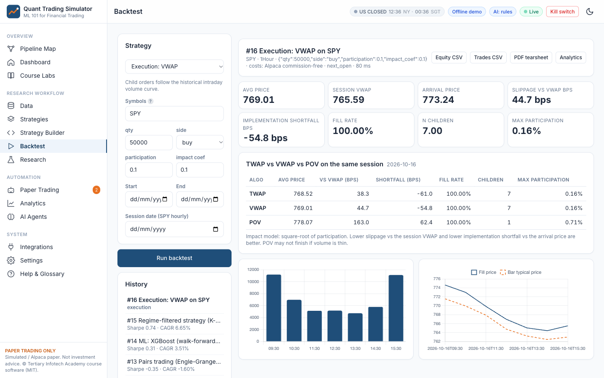

---

## 6. Research: hypothesis test, strategy search, walk-forward, ML models, regimes, A/B test, pairs, diagnostics

**Hypothesis test (Lab 04).** Write H1 and H0 first. Then pick a signal (losing streak, RSI below a level, close below an
SMA or the lower band, gap down), a horizon, alpha and the minimum edge. Read:

- the signal-day mean against the other-day mean
- Welch t and p
- the 95% bootstrap CI
- the decision
- the robustness grid and the Bonferroni alpha

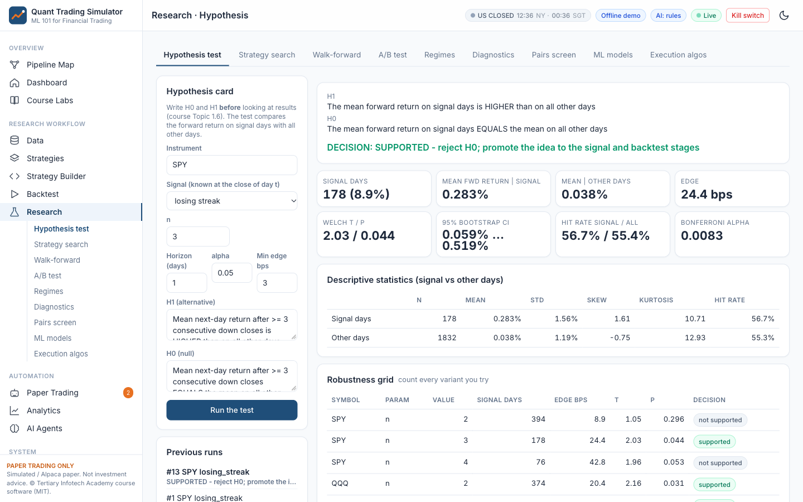

**Strategy search (Lab 10).** Grid-search the parameters on the **in-sample** period only, then read:

- the **IS and OOS Sharpe heatmaps**
- the IS→OOS rank correlation
- the top-5 decay
- the share of parameter sets that beat buy-and-hold out of sample
- the **robust region** (the best neighbour-average cell)

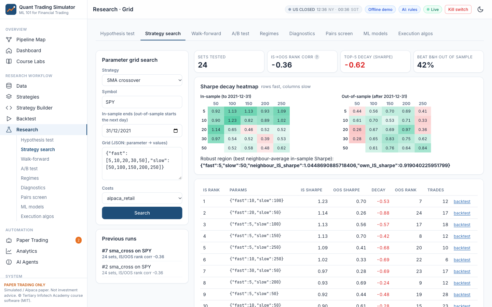

**Walk-forward (Lab 10).** For each window the app chooses parameters on the training window and applies them to the next unseen
window. The result is a stitched out-of-sample equity curve and the parameters chosen per window.

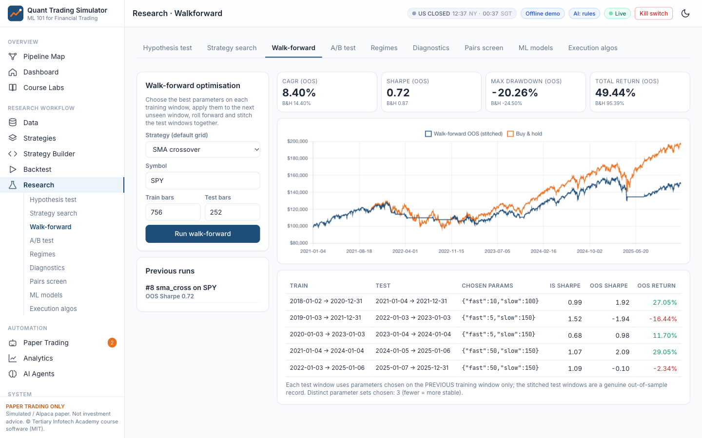

**ML models (Lab 11)** trains logistic regression, random forest and XGBoost walk-forward. Every 126 bars each model is
refitted on all the bars before that point (**in-sample**). With **Tune in-sample** ticked (the default), the first 75% of
that training window fits each candidate setting (C for logistic regression, tree depth for the forest and XGBoost), the
last 25% (**validation**) picks the best, and the winner is refitted on the whole window before it predicts the next 126
bars it has never seen (**out-of-sample**). The table shows the chosen setting, in-sample and validation AUC next to the
out-of-sample accuracy, AUC and net-of-cost backtest; the chart and **Walk-forward folds** show the same per refit. A high
in-sample AUC that falls to about 0.5 out-of-sample is overfitting.

**Regimes (Lab 12).** PCA explained variance and loadings (PC1 ≈ the market). The K-means regime profile, a walk-forward
regime timeline (refitted on past data only), and gated vs ungated performance: the signal is forced flat in the stress
regime.

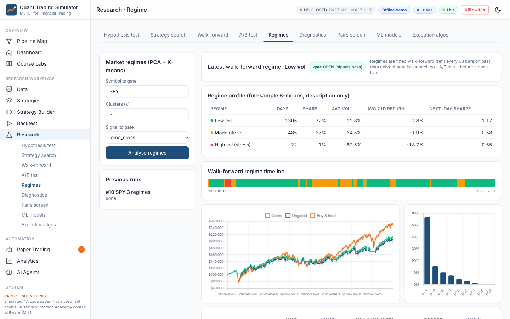

**A/B test (Lab 13).** Variants A and B run on the same days with the same costs. The page shows a Welch t-test, a paired
t-test on A − B, and a block-bootstrap 95% CI of the Sharpe difference. **The app rejects H0 only if the paired test and the
CI agree.** The multiple-testing note (Bonferroni) reminds you how many variants you tried.

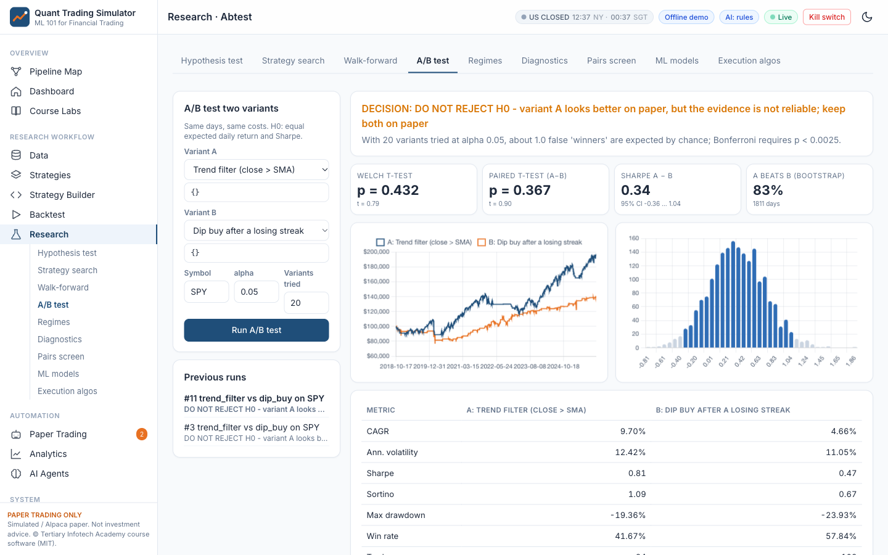

**Pairs screen (Lab 14)** compares correlation with the Engle-Granger ADF t-statistic, the hedge ratio and the half-life.

**Diagnostics (Lab 18).** Five checks, each marked PASS / WARN / FAIL with evidence, and a verdict (BLOCK or CLEAR for paper
trading):

1. look-ahead in features (truncation and future-shock)
2. look-ahead in execution (same-bar vs next-bar Sharpe)
3. cost drag and break-even
4. overfitting against the best of N skill-free random strategies
5. survivorship

Try the seeded **Lab 18 exhibit**. It FAILs because `rolling(center=True)` uses future bars. Fix it in the Strategy
Builder and re-run.

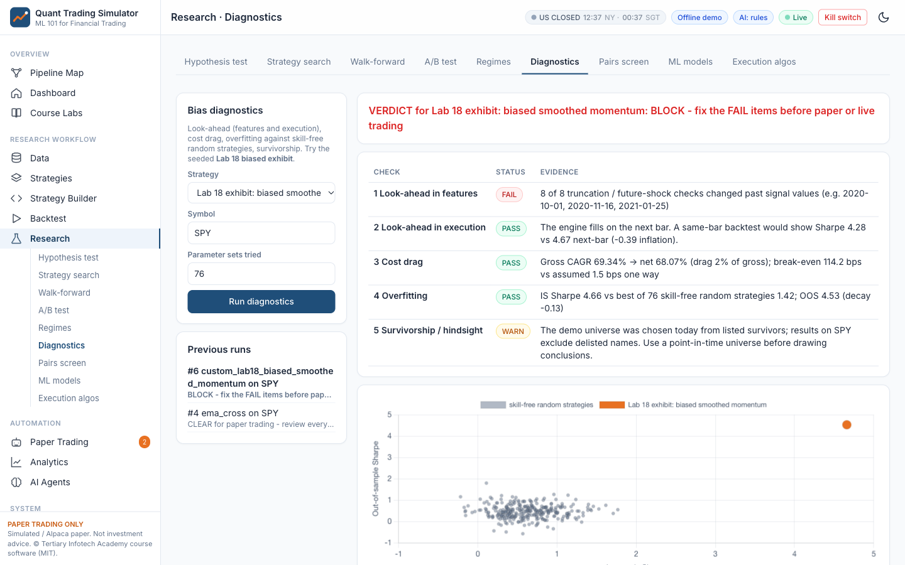

**Execution algos** compares TWAP, VWAP and POV on one session.

---

## 7. The multi-agent desk and human approval

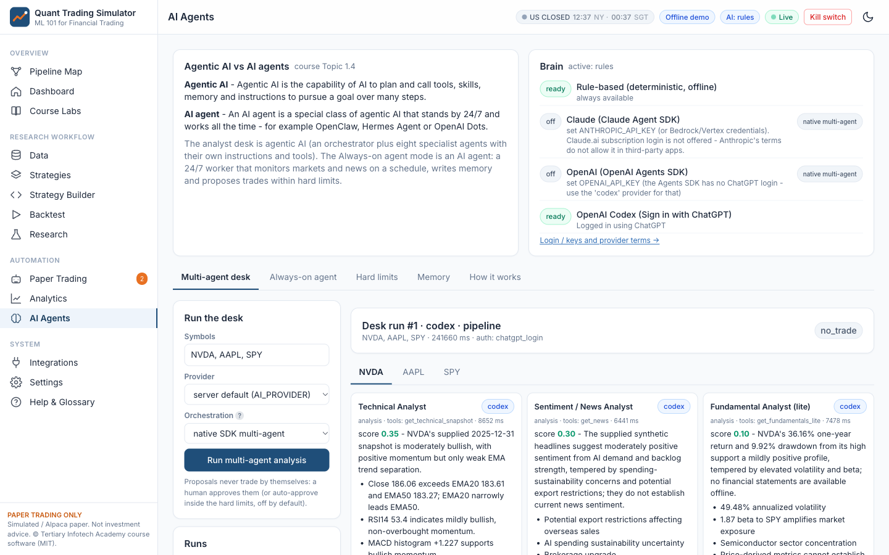

1. Open **AI Agents**. Read the taxonomy:
   - **Agentic AI** is the capability of AI to plan and call tools, skills, memory and instructions.
   - An **AI agent** is a special class of agentic AI that stands by 24/7 and works all the time (for example OpenClaw,
     Hermes Agent or OpenAI Dots).
2. Check the **Brain** card to see which providers are ready. Choose symbols, a provider and the orchestration:
   - *native* uses the SDK's own multi-agent features: Claude subagents, or OpenAI agents-as-tools.
   - *pipeline* makes one call per agent.
3. Press **Run multi-agent analysis**. For each symbol you see one card per agent:
   - the **Technical**, **Sentiment/News** and **Fundamental-lite** analysts, with their tools
   - the **Bull** and **Bear** researchers, who debate over two rounds and rebut each other
   - the **Trader**: buy, sell or hold, with confidence and size
   - the **Risk Manager**: an advisory review
   - the **Hard risk limits**: code, not an LLM. They cap the size, set ATR stops and targets, and enforce the allow-list
     and minimum confidence.
   - the **Portfolio Manager / Orchestrator**: the final recommendation
   
   Each card has a brain badge. If an LLM call fails, the rule brain answers instead and is marked *rules (fallback)*.
4. **Proposals awaiting human approval** lists each trade. Press **Approve paper orders** or **Reject**.
   - Approved buys become bracket orders in the regular session, or extended-hours limit orders outside it.
   - The decision is written to the audit log.
5. Under **Hard limits**, set the maximum position, maximum order value, minimum confidence and the ATR stop / target.
   **Auto-approve** (off by default) approves only proposals that pass every limit.

---

## 8. Forward testing: a paper-trading bot

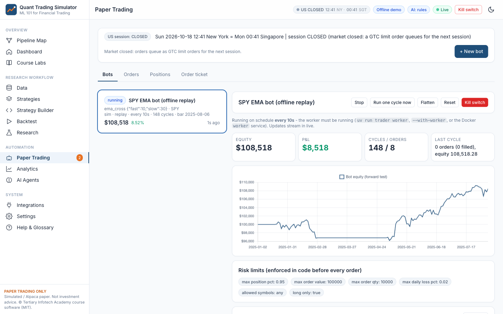

1. In **Paper Trading**, press **+ New bot** (or use **Forward-test as a bot** from a backtest). Choose:
   - the strategy and its parameters
   - the symbols
   - a **schedule**: cron in New York time (for example `35 9 * * 1-5`), or `every 10s` for demos
   - the **broker**: simulator, or Alpaca paper with keys
   - the **data mode**:
     - **replay**: offline. Each cycle replays one trading day: the bot sees bars up to yesterday's close and its orders
       fill at today's open.
     - **live**: latest data and the real clock.
   - the sizing and risk limits
2. Press **Start**. A worker must be running: `trader serve --with-worker`, `trader worker`, or the Docker `worker`
   service. You can also press **Run one cycle now**. The equity curve, cycles, orders and fills update live, and the
   Pipeline Map path lights up on each cycle.
3. **Kill switch.**
   - The bot's own **Kill switch** halts it and cancels its open orders.
   - The **global** kill switch in the top bar halts every bot, webhook, agent and manual order.
   - Every cycle is then recorded as *halted*.
4. **Backtest vs forward test.** Press **Compare** to overlay the forward curve on a backtest over the same bars, with
   tracking error and fill counts. Explain every material gap: whole shares, fill prices, risk resizing, timing.

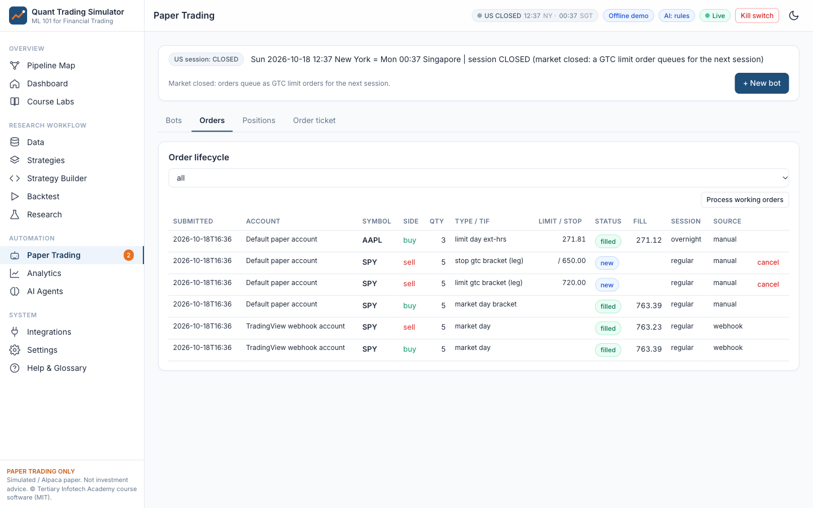

**Orders** is the lifecycle blotter. Click a status to expand its history (new → accepted → filled / canceled, with notes
and the `client_order_id`). Positions show realised and unrealised P&L. The **Order ticket** places manual paper orders:
market, limit, stop, bracket, DAY/GTC and extended hours. Each order shows every risk check.

**Singapore class hours.** A 09:00-18:30 SGT class falls in the US **overnight / pre-market** sessions. At those times the
app sends **LIMIT orders, time in force DAY, `extended_hours=True`**, priced off the latest quote ± 25 bps (Alpaca 24/5).
A market order is blocked. When the market is closed, orders queue as **GTC limits** for the next session. In the simulator
you can use the ticket's *Session (sim)* override to practise each session.

---

## 9. TradingView webhook set-up

1. Go to **Integrations > TradingView webhook**. Copy the **Webhook URL** and the **alert message** JSON (use **Reveal
   secret** on your own machine only). You can set your own secret with `WEBHOOK_SECRET` in `.env`.
2. Press **Run self-test**. Seven simulated alerts should give the expected HTTP codes:
   - 200: valid buy and sell
   - 401: wrong secret
   - 422: symbol not allowed, quantity too large
   - 400: malformed message
   - 200 *duplicate ignored*: a retry of an earlier alert
3. Real alerts need a paid TradingView plan and a public HTTPS URL, for example `ngrok http 8000`. Then:
   1. Add the exported Pine strategy to a chart.
   2. Create an alert with the URL `https://<tunnel>/api/webhooks/tradingview` and the message.
   3. Optionally tick **Reject alerts that disagree with the app's own signal** (HTTP 409).

Every alert is written to the audit log with the secret redacted. Its order appears in Paper Trading with source *webhook*.

---

## 10. Performance analytics and the tearsheet

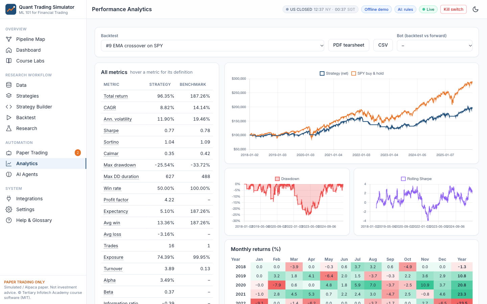

**Analytics** shows every metric (with the benchmark), equity vs benchmark, drawdown, rolling Sharpe, monthly returns, the
cost table and the trades. You can also:

- **Compare runs side by side.** Tick 2-5 backtests to see their metrics table and normalised equity curves.
- **Compare a bot with its backtest.** Choose a bot to see backtest vs forward test.
- **Export.** Use **PDF tearsheet** (one page: equity vs benchmark, drawdown, monthly heatmap, metrics, costs) and **CSV**.

---

## 11. The always-on AI agent

Go to **AI Agents > Always-on agent**. Enable the agent and set its wake-up interval, watch list and provider. On every
wake-up the agent:

1. refreshes the headlines
2. runs the full multi-agent desk
3. writes **memory** notes
4. leaves proposals for your approval, or auto-approves them inside the hard limits if you enabled that

**Wake it now** runs it once immediately. The worker heartbeat shows whether a worker is running.

---

## 12. Settings and integrations

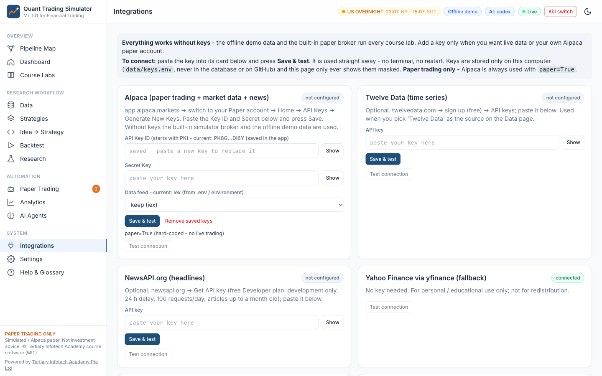

**Integrations** has a card for each service: Alpaca, Twelve Data, NewsAPI, Equibles, yfinance, TradingView, OpenAI Codex (Sign in
with ChatGPT), Claude (Agent SDK, API key), OpenAI Agents SDK, and the database. Each card shows:

- the connection status, with values **masked**
- where to get the key
- the exact **login command**, with a copy button
- the **provider terms** (quoted, with links)
- a **Test connection** button

**To connect a service, paste its key into the card and press Save & test** - no terminal, no text editor, no restart.
The key is stored only on this computer in `data/keys.env` (private to your user account, git-ignored, never in the
database) and every page shows it masked. **Remove saved keys** clears it. Everything works without keys: the offline demo
data and the built-in paper broker run every lab. Advanced users can still set the same variables in `.env`; a key saved in
the app takes precedence.

> **Claude.ai subscription login is not offered.** Anthropic's terms do not allow third-party apps to offer it. The Claude
> provider uses an API key or cloud credentials. The OpenAI Codex provider reuses **your own** `codex login` on your
> machine. The app never reads or stores tokens.

**Settings** covers:

- theme, user name (for lab progress), default symbol and cost model
- the global kill switch
- **Load / refresh demo data**
- the read-only environment
- the about section and the disclaimer

---

## 13. Glossary of metrics

Returns are simple daily returns, and annualised figures assume 252 trading days (course Topic 2.5).

| Metric | Formula | Meaning |
|---|---|---|
| **Total return** | `prod(1 + r) - 1` | Overall percentage gain or loss over the whole test. |
| **CAGR** | `(1 + total return)^(252/N) - 1` | Compound annual growth rate - the constant yearly return that gives the same result. |
| **Ann. volatility** | `stdev(daily r) x sqrt(252)` | How much returns swing around their average, annualised. |
| **Sharpe** | `mean(r - rf) / stdev(r - rf) x sqrt(252)` | Return per unit of total risk. Above 1 is good for a single strategy; above 2 is rare. |
| **Sortino** | `mean(r - rf) / downside deviation x sqrt(252)` | Like Sharpe but only penalises downside volatility (losses). |
| **Calmar** | `CAGR / \|max drawdown\|` | Growth earned per unit of worst drawdown. |
| **Max drawdown** | `min(Equity / running peak - 1)` | Worst peak-to-trough fall of the equity curve. |
| **Max DD duration** | `longest run of bars below a peak` | How long (in bars) the strategy stayed under water. |
| **Win rate** | `winning trades / all trades` | Share of round-trip trades that made money. |
| **Profit factor** | `gross profit / gross loss` | Above 1 = winners outweigh losers. 1.5+ is healthy. |
| **Expectancy** | `p(win) x avg win - p(loss) x \|avg loss\|` | Average return you can expect per trade. |
| **Avg win** | `mean(winning trade returns)` | Average return of winning trades. |
| **Avg loss** | `mean(losing trade returns)` | Average return of losing trades. |
| **Trades** | `count of round trips` | Number of completed (or open, marked-to-market) round-trip trades. |
| **Exposure** | `bars with a position / all bars` | Time in the market. |
| **Turnover** | `annual sum of \|change in position\|` | How often the book is traded: 1.0 = one full in-or-out per year. |
| **Alpha** | `annualised CAPM intercept vs benchmark` | Return not explained by exposure to the benchmark. |
| **Beta** | `cov(r, benchmark) / var(benchmark)` | Sensitivity to the benchmark: 1 = moves with the market, 0 = market neutral. |
| **Information ratio** | `mean(r - m) / stdev(r - m) x sqrt(252)` | Consistency of out-performance versus the benchmark. |
| **Total costs** | `commission + spread + slippage + fees + borrow` | Every dollar paid to trade. |
| **Break-even cost** | `one-way bps at which net CAGR = 0` | How much cost per trade the strategy can absorb before it stops making money. |

**Other terms**

- **Look-ahead bias:** using information that was not available at the decision time.
- **Survivorship bias:** testing only on today's survivors.
- **Overfitting / data snooping:** parameters tuned to noise, or reporting the best of many tests.
- **Cointegration:** a weighted combination of two prices is stationary (the ADF t-statistic is below the critical value).
- **Walk-forward:** train on the past, test on the next unseen block, roll forward.
- **Implementation shortfall:** the execution price against the arrival price.
- **VWAP / TWAP / POV:** volume-weighted, time-weighted and percentage-of-volume execution.

The **Help & Glossary** page in the app also covers the course topics, the algorithm explainers and the agentic-AI
comparison.
